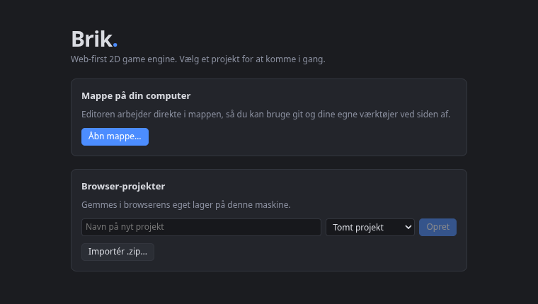
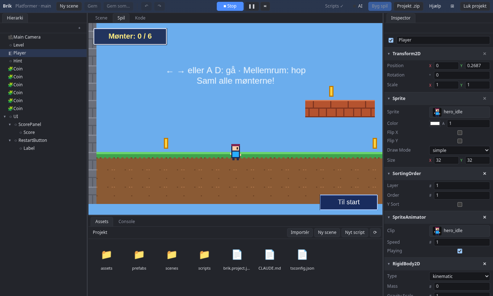
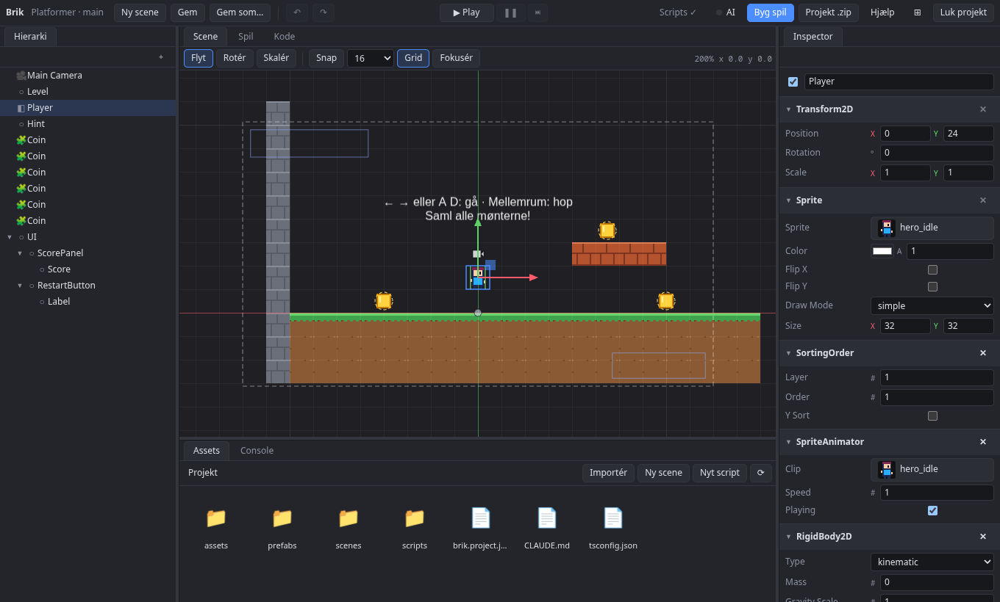

# Dit første spil

I denne guide åbner du editoren, starter fra platformer-eksemplet, spiller det og ændrer det, så det bliver dit eget. Det tager et kvarter.

## 1. Start editoren

```bash
make editor
```

Åbn [http://localhost:5180](http://localhost:5180).

## 2. Opret et projekt

Vælg **Browser-projekt** (nemmest at starte med) og skabelonen **Platformer-eksempel**. Du får en bane, en figur og mønter.



## 3. Spil det

Tryk **Ctrl+P**, eller åbn **Spil**-fanen og start spillet. Styr figuren med A/D eller piletasterne, og hop med Space. Tryk Ctrl+P igen for at stoppe.



> **Bemærk** Ændringer, du gør under Play, forsvinder, når du stopper. Stop altid, før du redigerer.

## 4. Ret en værdi

1. Vælg figuren i **Hierarki**.
2. Find dens script (`Player`) i **Inspector**. Felterne med `@expose` står der: `speed`, `jumpSpeed`, `gravity`.
3. Sæt `jumpSpeed` op, og tryk Play. Figuren hopper højere.



Fortryd med **Ctrl+Z**, hvis det blev for vildt.

## 5. Mal på banen

1. Vælg **Level** i hierarkiet. Det er banens tilemap.
2. Vælg en tile i inspectoren, og mal i scene view med **B** (pensel).
3. **X** er viskelæder, og **Esc** stopper malingen.

Læs mere i [Tilemaps](../manual/tilemaps.md).

## 6. Gem

Tryk **Ctrl+S**. Browser-projekter gemmes i browseren, mappeprojekter i mappen.

## Næste skridt

- [Tilføj en fjende](tilfoej-en-fjende.md)
- [Lav en menu](lav-en-menu.md)
- [Udgiv på itch.io](udgiv-paa-itch.md)
