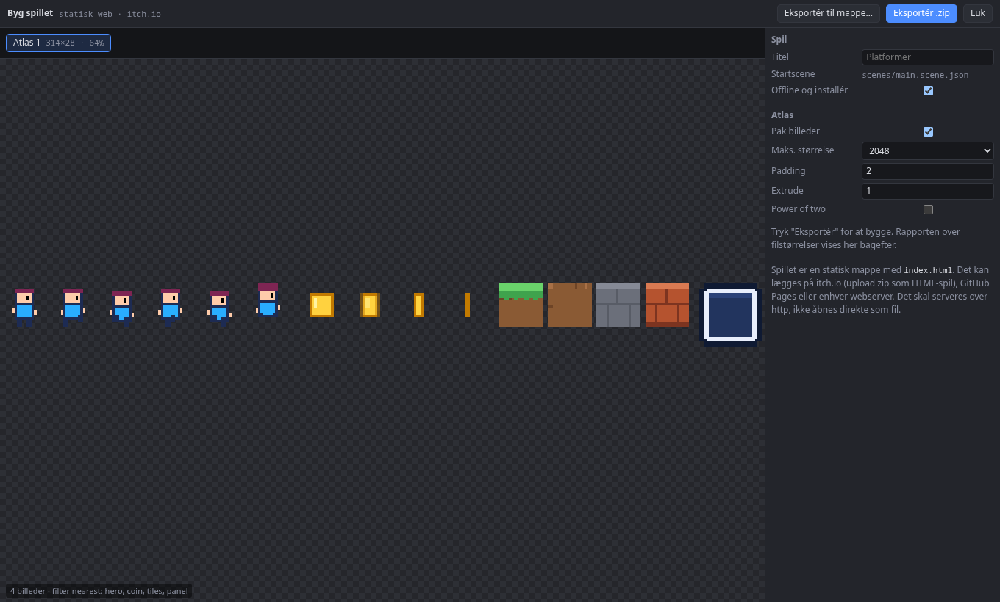

# Udgiv på itch.io

## 1. Byg

Tryk **Byg spil** i menulinjen. Brik pakker billederne i atlasser og viser eventuelle advarsler.

## 2. Eksportér

Vælg **Eksportér .zip**.

## 3. Upload

1. Opret et projekt på itch.io med typen **HTML**.
2. Upload zip-filen, og vælg "This file will be played in the browser".
3. Gem, og åbn siden for at prøve spillet.

## Andre steder

**Eksportér til mappe** skriver filerne ud, så de kan lægges på GitHub Pages, Netlify eller en anden webserver. Spillet skal åbnes over http; det virker ikke at dobbeltklikke `index.html`. Til en hurtig test lokalt kan du køre `npx serve` i mappen.

## Ikon og offline

Læg en kvadratisk `icon.png` (mindst 192 px) i projektets rod for at få dit eget ikon. Spillet kan som standard startes uden forbindelse efter første besøg, og browseren kan tilbyde at installere det. Læs mere i [Byg og udgiv](../manual/byg-og-udgiv.md).
