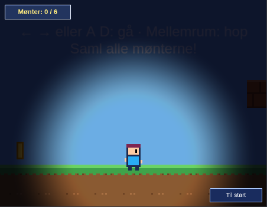
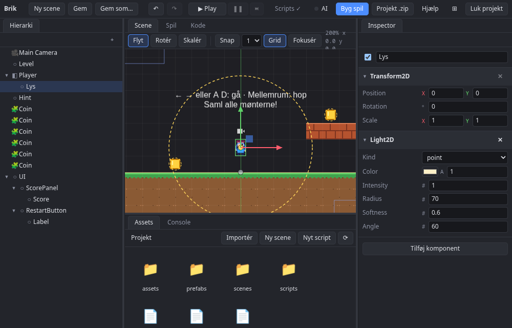
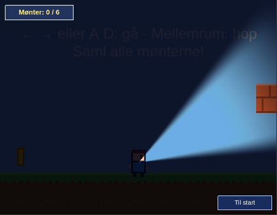
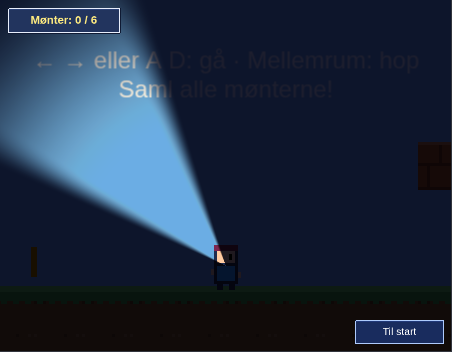
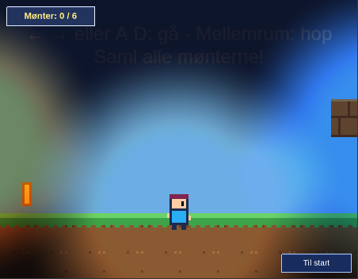

# Lys og mørke

Med `Lighting2D` og `Light2D` kan du lave et mørkt spil med lys, fx en lommelygte, en fakkel eller en lanterne. Det tager et par minutter.



## Sådan virker det

- **`Lighting2D`** sættes på kameraet og slår belysning til for det. Dens `ambient` er det lys, der er overalt: sort er helt mørkt, hvidt er ingen mørkelægning.
- **`Light2D`** er en lyskilde. Den lyser op omkring sig og lægges oven i omgivelseslyset.
- Alt, hvad kameraet tegner i verden, ganges med lyset. **UI'et bliver ikke mørkere**, så point og knapper kan altid ses.

## 1. Gør kameraet mørkt

Vælg **Main Camera** i hierarkiet, tryk **Tilføj komponent**, og vælg `Lighting2D`. Tryk Play: nu er hele banen mørk. Sæt `ambient` lysere for et dunkelt spil og næsten sort for en grotte.

## 2. Tilføj et lys

Tryk **+** i hierarkiet og vælg **Lys**. Du får en entity med `Light2D`, og i Scene-fanen ses dens rækkevidde som en gul stiplet cirkel.



Træk lyset ind under **Player** i hierarkiet, så følger det med spilleren. Står dets position på 0, 0, sidder det midt på figuren.

Felterne i inspectoren:

| Felt | Betydning |
|---|---|
| `kind` | `point` (lyser til alle sider) eller `spot` (en kegle) |
| `color` | Lysets farve. Varmt gult er en fakkel, blåt er måneskin |
| `intensity` | Styrken. 1 lyser fuldt i midten, mindre giver et svagere lys |
| `radius` | Hvor langt lyset når, i verdensenheder. Brug en lille værdi, hvis kameraet er zoomet ind (platformer-eksemplet viser kun ca. 225 enheder i bredden) |
| `softness` | 0 giver en skarp kant, 1 et lys, der falder blødt af fra midten |
| `angle` | Keglens åbning i grader (kun `spot`) |

Entity'ens skala ændrer rækkevidden. Skruer du lidt op og ned på `intensity` fra et script, flakker lyset som et bål.

## 3. Lommelygte

Sæt `kind` til `spot`. Lyset peger langs entity'ens rotation: 0 er mod højre, og positiv rotation drejer mod uret.



Vil du have lygten til at pege mod musen, så sæt dette script på **spilleren**. Det drejer lys-entity'en under spilleren (den skal hedde **Lys**, som den gør fra start):

```ts
import { Behaviour, Transform2D } from "brik";

export class Flashlight extends Behaviour {
  onUpdate() {
    const light = this.find("Lys"); // lys-entity'en under spilleren
    if (light < 0) return;
    const mouse = this.pointerWorld();
    const p = this.transform.position; // spilleren ligger øverst i hierarkiet: det er verdensplaceringen
    this.world.store(Transform2D).rotation[light] = Math.atan2(mouse.y - p.y, mouse.x - p.x);
  }
}
```



## 4. Flere lys

Du kan have lige så mange lys, du vil. De lægges sammen, så to lys, der overlapper, giver et lysere område, og hvert lys kan have sin egen farve.



## Begrænsninger

- **Ingen skygger.** Lyset går igennem vægge og tiles. Skygger kommer senere.
- **Ingen normal maps.** Spritene er lige lyse over hele fladen.
- **Lys kan ikke gøre noget lysere end det, det var.** Lys fjerner kun mørke: er en sprite fuldt lys, kan et lys ikke brænde den ud.
- **Alt i verden bliver påvirket ens.** Man kan ikke udelukke enkelte sprites eller lag fra belysningen.
- **Scene-fanen er altid lys.** Lyset ses kun i Spil-fanen under Play, men gizmoen i Scene viser, hvor lysene er og hvor langt de når, så du kan redigere uden at stå i mørke.
- Hvert kamera slår belysning til for sig selv. Et kamera uden `Lighting2D` tegner alt fuldt oplyst.
