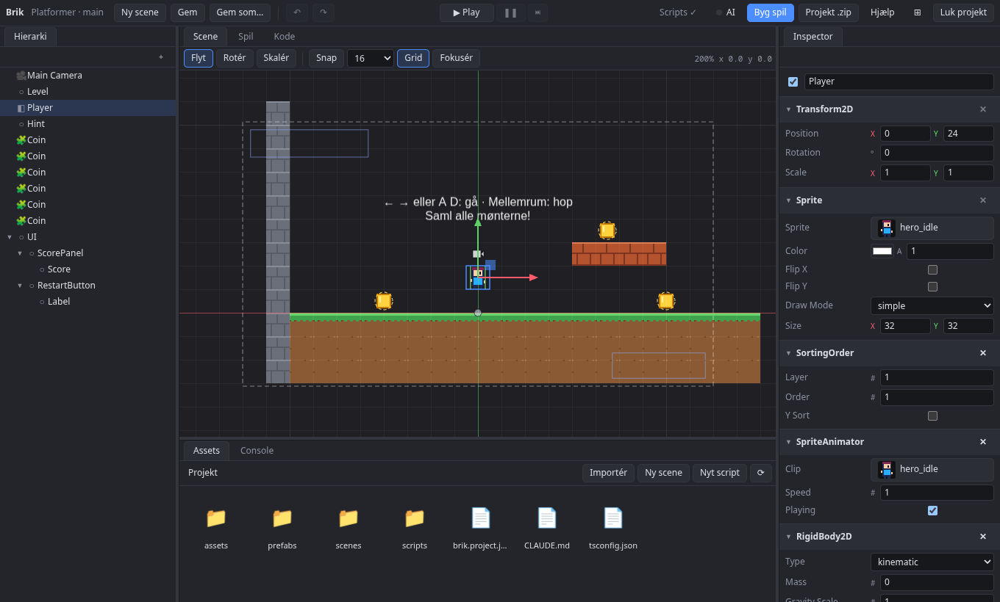
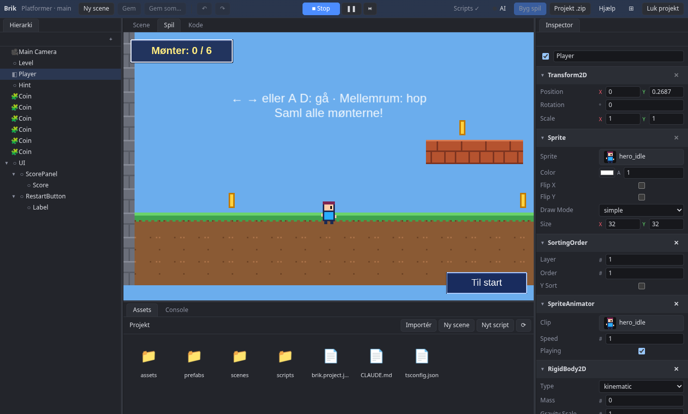

# Editoren

## Panelerne

| Område | Brug |
|---|---|
| Hierarki (venstre) | Entities i scenen. "+" eller højreklik opretter. Træk for at ændre forælder. |
| Scene (midten) | Flyt (W), rotér (E), skalér (R). Højreklik-træk panorerer, hjulet zoomer (Shift + hjul: sidelæns, Ctrl + hjul: op og ned), F fokuserer. |
| Spil | Spillet set gennem kameraet, inklusive UI. Ctrl+P er Play/Stop. |
| Kode | Scripts med autocomplete. Ctrl+S gemmer og genindlæser. |
| Inspector (højre) | Komponenter på den valgte entity, eller indstillinger for det valgte asset |
| Assets (bund) | Projektets filer. Træk billeder, animationer, prefabs og lyde ind i scenen. |

Panelerne kan flyttes: træk en fane hen på et andet område, eller højreklik fanen og vælg "Flyt til …". Fx kan Scene og Spil ligge ved siden af hinanden. Knappen ⊞ i menulinjen sætter panelerne tilbage, hvor de var fra start.

Under Play viser Spil-fanen spillet set gennem kameraet, med UI'et:

## Genveje

| Genvej | Gør |
|---|---|
| W / E / R | Flyt, rotér, skalér |
| F | Fokusér på den valgte entity |
| Ctrl+P | Play / Stop |
| Ctrl+S | Gem |
| Ctrl+Z | Fortryd |
| Højreklik-træk, hjul | Panorér og zoom i scene view |
| Shift + hjul, Ctrl + hjul | Panorér sidelæns, og op og ned (Cmd + hjul på Mac). Vandret rulning på en touchpad panorerer også sidelæns |

## Fortryd

Alt kan fortrydes med Ctrl+Z. Ændringer under Play forsvinder, når du stopper.

> **Bemærk** Scenen kan ikke redigeres, mens spillet kører. Stop først.

## Gem og gendan

Ændringer, der ikke er gemt, lægges løbende i `.brik/recovery.json`. Lukkes editoren, eller genindlæses siden, før du har gemt, spørger Brik næste gang projektet åbnes, om ændringerne skal gendannes. Selve scenefilen røres først, når du gemmer.

## Console

Console viser fejl i scripts med fil og linje, både ved kompilering og mens spillet kører. Klik på en fejl for at hoppe til linjen. Det, en AI-klient gør, står her også.

## Hjælp

Knappen **Hjælp** i menulinjen åbner denne dokumentation i en ny fane.
