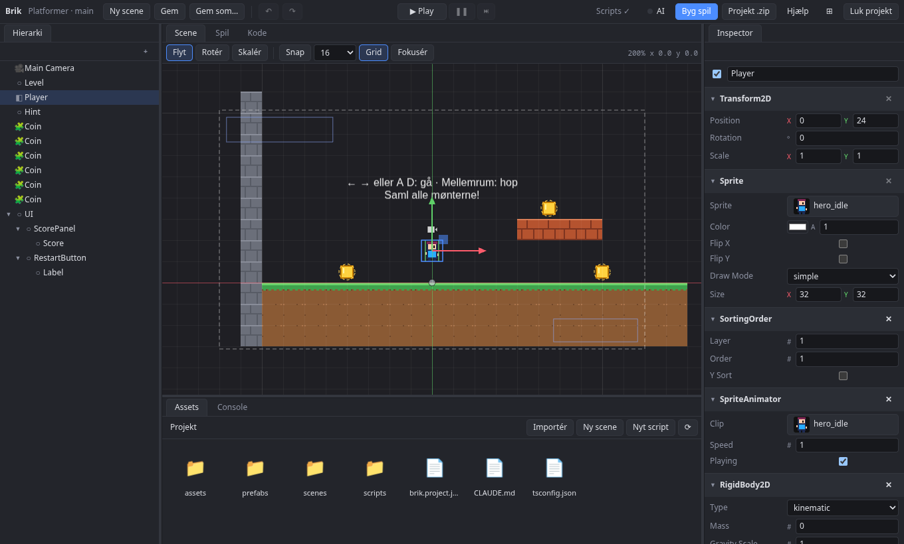
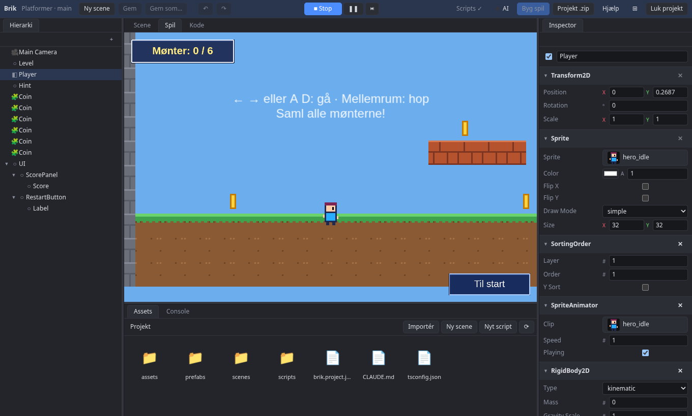

# Editoren

## Panelerne

| Område | Brug |
|---|---|
| Hierarki (venstre) | Entities i scenen. "+" eller højreklik opretter. Træk for at ændre forælder. |
| Scene (midten) | Flyt (W), rotér (E), skalér (R). Højreklik-træk panorerer, hjulet zoomer (Shift + hjul: sidelæns, Ctrl + hjul: op og ned), F fokuserer. |
| Spil | Spillet set gennem kameraet, inklusive UI. Ctrl+P er Play/Stop. Knappen **Collidere** i hjørnet viser fysikkens former under Play. |
| Kode | Scripts med autocomplete. Ctrl+S gemmer og genindlæser. |
| Inspector (højre) | Komponenter på den valgte entity, eller indstillinger for det valgte asset |
| Assets (bund) | Projektets filer. Træk billeder, animationer, prefabs og lyde ind i scenen. |

Panelerne kan flyttes: træk en fane hen på et andet område, eller højreklik fanen og vælg "Flyt til …". Fx kan Scene og Spil ligge ved siden af hinanden. Venstre og højre kolonne kan deles i en øvre og en nedre del, fx Hierarki over Assets. Træk en fane til den nederste kant af kolonnen, og træk i skillelinjen for at ændre fordelingen.

Dobbeltklik en fane (eller vælg "Flydende vindue" i højreklik-menuen) for at give panelet sit eget vindue oven på editoren. Træk vinduet i titellinjen, og ændr størrelsen i nederste højre hjørne. Slip vinduet over et område for at dokke det igen, eller dobbeltklik titellinjen for at sende det tilbage, hvor det hørte til. Knappen ⊞ i menulinjen sætter panelerne tilbage, hvor de var fra start.

Under Play viser Spil-fanen spillet set gennem kameraet, med UI'et:

## Genveje

| Genvej | Gør |
|---|---|
| W / E / R | Flyt, rotér, skalér |
| F | Fokusér på den valgte entity |
| Ctrl+P | Play / Stop |
| Ctrl+S | Gem |
| Ctrl+Z | Fortryd |
| Ctrl+C / Ctrl+X / Ctrl+V | Kopiér, klip og indsæt entities (også til en anden scene eller et andet projekt) |
| Ctrl+D | Dupliker de valgte entities, eller den valgte prefab i Assets |
| Højreklik-træk, hjul | Panorér og zoom i scene view |
| Shift + hjul, Ctrl + hjul | Panorér sidelæns, og op og ned (Cmd + hjul på Mac). Vandret rulning på en touchpad panorerer også sidelæns |

## Kopiér og indsæt

Kopierede entities kommer med deres børn og bliver sat ind ved siden af den valgte entity (eller øverst i hierarkiet, når intet er valgt), samme sted i verden. UI-elementer havner under en UI Canvas. Kopien lægges også på systemets udklipsholder, så den kan sættes ind i et andet projekt. Prefab-instanser forbliver koblet til deres prefab, hvis projektet har den. Ellers bliver de almindelige entities.

## UI i scene view

Et valgt UI-element har håndtag i hjørner og på kanter. Træk i dem for at ændre størrelsen; den modsatte kant bliver stående. Snap (eller Ctrl under træk) runder størrelsen til gitteret.

## Fortryd

Alt kan fortrydes med Ctrl+Z. Ændringer under Play forsvinder, når du stopper.

> **Bemærk** Scenen kan ikke redigeres, mens spillet kører. Stop først.

## Gem og gendan

Ændringer, der ikke er gemt, lægges løbende i `.brik/recovery.json`. Lukkes editoren, eller genindlæses siden, før du har gemt, spørger Brik næste gang projektet åbnes, om ændringerne skal gendannes. Selve scenefilen røres først, når du gemmer.

Kode, der ikke er gemt i Kode-panelet, lægges på samme måde i `.brik/recovery-scripts.json`. Næste gang åbnes filerne igen med ændringerne, markeret som ikke gemt, så du kan gemme dem med Ctrl+S eller lukke dem.

Åbner du en anden scene, laver en ny eller lukker projektet, mens scenen har ændringer, spørger Brik, om de skal gemmes først: **Gem**, **Kassér** eller **Annullér**.

## Console

Console viser fejl i scripts med fil og linje, både ved kompilering og mens spillet kører. Klik på en fejl for at hoppe til linjen. Det, en AI-klient gør, står her også.

## Hjælp

Knappen **Hjælp** i menulinjen åbner denne dokumentation i en ny fane.
