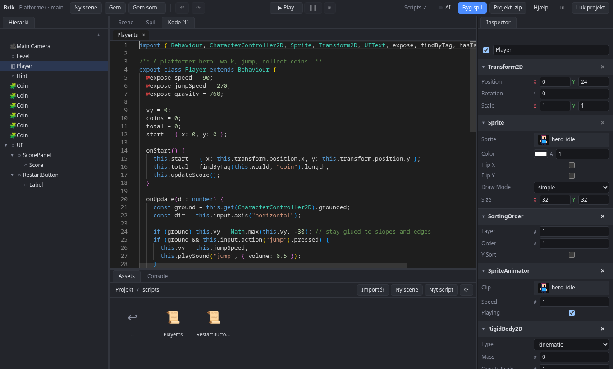

# Scripts

Scripts er TypeScript-filer i `scripts/`. En `Behaviour` sættes på en entity via **Tilføj komponent** i inspectoren.

```ts
import { Behaviour, expose, Sprite } from "brik";

export class Player extends Behaviour {
  @expose speed = 120;            // kan rettes i inspectoren

  onStart() {}                    // én gang
  onUpdate(dt: number) {          // hver frame
    const x = this.input.axis("horizontal");
    this.transform.position.x += x * this.speed * dt;
    this.get(Sprite).flipX = x < 0;
  }
}
```

Felter med `@expose` kan rettes i inspectoren, og værdien gemmes i scenen.



## Hooks

| Hook | Kaldes når |
|---|---|
| `onStart` | Scriptet starter |
| `onEnable` / `onDisable` | Entity'en tændes eller slukkes med `setActive` (også via en forælder). `onEnable` kommer også lige før `onStart`, og `onDisable` før `onDestroy` |
| `onUpdate(dt)` | Hver frame |
| `onFixedUpdate(dt)` | Ved et fast interval (60 Hz) |
| `onDestroy` | Scriptet eller entity'en fjernes |
| `onCollisionEnter/Exit(other)` | To faste colliders rører hinanden eller slipper |
| `onTriggerEnter/Exit(other)` | Noget går ind i eller ud af en trigger |
| `onAnimationEvent(name)` | Animationen når en frame med et event |
| `onAnimationFinished(clip)` | En animation, der kun spiller én gang, er færdig |
| `onTimer` | Entity'ens `Timer` løber ud |
| `onClick` | Entity'ens `UIButton` klikkes |

UI-elementernes hooks (`onValueChanged`, `onSubmit`) står i [UI](ui.md).

## Hjælpere

| Hjælper | Hvad den gør |
|---|---|
| `this.transform`, `this.get(Komponent)`, `this.add(...)`, `this.has(...)` | Læser og ændrer komponenter |
| `this.input.axis("horizontal")`, `this.input.action("jump").pressed`, `this.input.key("Mouse0").down` | Input |
| `this.pointerWorld()` | Musens position i verden |
| `this.moveCharacter(dx, dy)` | Bevæger en `CharacterController2D` med kollisioner |
| `this.playAnimation("hero_run")`, `this.playSound("coin")` | Animation og lyd |
| `this.spawnPrefab("Coin", { position })`, `this.destroy(e)`, `this.find("Navn")` | Opretter, fjerner og finder entities |
| `this.setActive(false, e)` | Slukker en entity og dens børn (fx en beskedboks): den skjules, dens scripts, timere og tweens holder pause, og dens colliders er ude af fysikken |
| `this.tween(Transform2D, "position.y", 100, 0.5)`, `this.after(1, fn)`, `this.every(0.5, fn)` | Tweens og timere |
| `this.emitParticles(20)` | Udsender partikler |
| `this.loadScene("level2", { fade: 0.4, data })` | Skifter scene, evt. med fade og data, der læses med `this.sceneData` |
| `this.shakeCamera(8, 0.3)`, `this.punchCamera(0.08)`, `this.hitStop(0.06)`, `this.slowMotion(0.3, 1)` | Skærmryst, zoom-stød, frys og slowmotion ([Grafik](grafik.md#skaermryst-zoom-stoed-og-hit-stop)) |
| `this.behaviourOf(Andet, e)` | Taler med et andet script |

> **Pas på** Giv ikke dine egne metoder samme navn som Behaviours egne (fx `setActive` eller `find`), for så skygger de for dem.

## Felter, der peger på andet

Et felt kan pege på en anden entity, som du vælger i inspectoren:

```ts
@expose({ type: "entity" }) target: Entity = -1; // -1 hvis intet er valgt
```

Felter af typen `"prefab"`, `"audio"` og `"clip"` får en asset-vælger.

> **Pas på** Et `Entity` er et indeks, og indekser genbruges, når en entity slettes. Et felt, der pegede på en slettet entity, kan derfor pludselig pege på en ny, uvedkommende entity, og `this.world.isAlive(target)` siger da `true`. Skal en reference kunne overleve, at målet slettes, så gem en `EntityRef` og slå den op, hver gang du bruger den:
>
> `const ref = this.world.ref(e);` og senere `const e = this.world.deref(ref);` (giver `-1`, hvis entity'en er væk).

## Når noget forsvinder

`onCollisionExit` og `onTriggerExit` kommer også, når modparten slettes, slukkes (`setActive`) eller filtreres væk af en ny `group`/`mask`. Er modparten slettet, er `other` indekset på en entity, der ikke findes mere, og den slettede entity får selv ingen exit-hook (kun `onDestroy`). Tjek derfor, før du bruger `other`. Husk en `EntityRef` ved Enter, og slå den op ved Exit:

```ts
import { Behaviour, type EntityRef } from "brik";

export class Zone extends Behaviour {
  inside = new Map<number, EntityRef>();

  onTriggerEnter(other: number) {
    this.inside.set(other, this.world.ref(other));
  }

  onTriggerExit(other: number) {
    const ref = this.inside.get(other);
    this.inside.delete(other);
    // -1: modparten er slettet, og `other` må ikke bruges til at læse komponenter
    const alive = ref !== undefined && this.world.deref(ref) >= 0;
    if (alive) this.log("gik ud:", other);
  }
}
```

## Egne komponenter og systemer

Scripts kan definere egne komponenter (`defineComponent`) og systemer. Se [Entities og komponenter](entities-og-komponenter.md#systemer).
