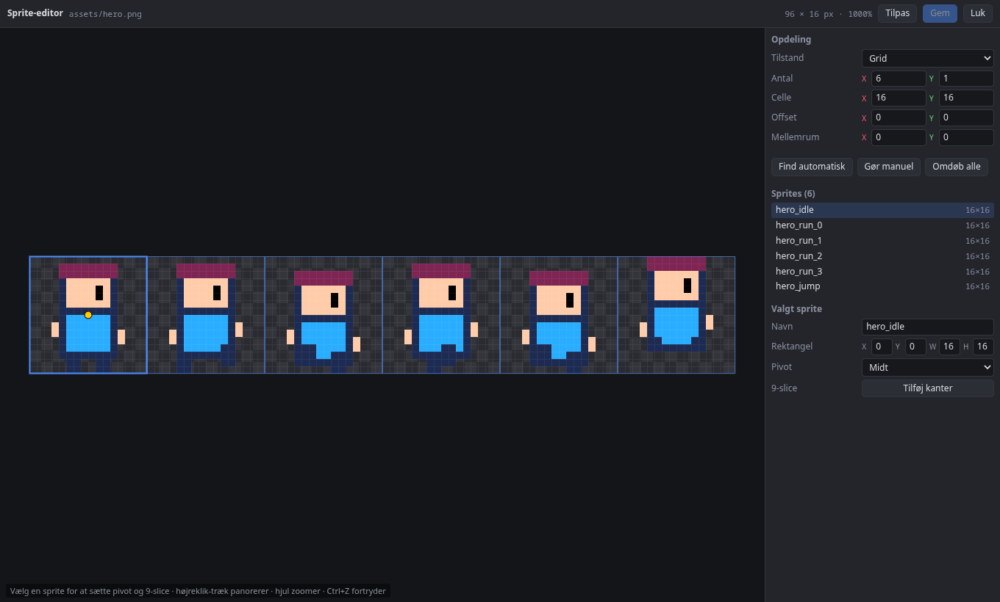

# Grafik

## Importér billeder

Importér PNG-filer med knappen eller ved at trække dem ind i asset-panelet.

## Sprite-editoren

Sprite-editoren åbnes, når du dobbeltklikker et billede.



Her kan du:

- opdele billedet i et grid, finde sprites automatisk eller tegne dem selv. Grid starter med én celle pr. figur i billedet, og under "Antal" kan du skrive kolonner og rækker i stedet for cellestørrelse. Til animationer er grid bedst, fordi alle frames så er lige store,
- sætte pivot,
- sætte 9-slice-kanter, som bruges til UI-paneler og knapper og til sprites med `drawMode: sliced`, der strækkes til en `size` uden at hjørnerne forvrænges (fx platforme og skilte).

## Animationer

Vælg et opdelt billede og tryk **Lav animation**. Dobbeltklik `.anim.json` for at åbne tidslinjen. Der kan du trække frames rundt, ændre varighed ved at trække i kanten, bruge onion skin og sætte events på frames. Et event kommer til `onAnimationEvent(name)` i scriptet på samme entity.

Fra et script: `this.playAnimation("hero_run")`.

## Fra andre værktøjer

- **Aseprite og TexturePacker:** Importér `.png` og `.json` sammen. Du får sprites, og Aseprite-tags bliver til animationer.
- **Tiled:** Se [Tilemaps](tilemaps.md#fra-tiled).

## Kamera

Kameraet bestemmer, hvad Spil-fanen viser. Lad det følge spilleren med `CameraFollow2D`. Slå `useBounds` til og sæt `bounds` til banens kanter, så holder kameraet hele udsnittet inden for banen, uanset hvor stort vinduet er.

### Skærmryst, zoom-stød og hit-stop

Fire kald fra et script giver spillet vægt. De ændrer kun, hvad der tegnes: kameraets entity flyttes ikke, så `CameraFollow2D` og grænserne virker som før, og UI'et ryster ikke.

| Kald | Virkning |
|---|---|
| `this.shakeCamera(8, 0.3)` | Ryster skærmen højst 8 pixel og aftager over 0,3 sekunder. Flere ryst lægges sammen |
| `this.punchCamera(0.08, 0.2)` | Zoomer hurtigt 8 % ind og glider tilbage. Et negativt tal zoomer ud |
| `this.hitStop(0.06)` | Fryser spillet i 0,06 sekunder, fx når et slag rammer. Animation, fysik og scripts står stille |
| `this.slowMotion(0.3, 1)` | Kører spillet med 30 % hastighed i 1 sekund og vender så tilbage |

Tiderne er rigtige sekunder, så et hit-stop varer lige længe, også i slowmotion. Et ryst ser ens ud hver gang, så et spil kan afspilles ens igen. Uden for scripts: `world.resource(CameraFX)` har de samme metoder plus `stop()`.

```ts
onCollisionEnter(other: number) {
  this.shakeCamera(6, 0.25);
  this.hitStop(0.05);
}
```

Til at lægge en farve over hele skærmen, fx et rødt blink ved skade, er der `world.resource(ScreenFade)` med `r`, `g`, `b` og `alpha` (0 tegner ingenting). Den ligger ovenpå alt, også UI.

## Partikler, tekst og former

| Komponent | Bruges til |
|---|---|
| `ParticleEmitter2D` | Partikler. De kan spille i verdens- eller lokale koordinater (`space`). Fra et script: `this.emitParticles(20)`. |
| `Text2D` | Tekst i verden |
| `Shape2D` | Udfyldte og optegnede former. Gode til prototyper og fejlsøgning |
| `SpriteAnimator` | Afspiller en animation |

Alle felter står i [Komponentreferencen](komponenter.md).

## Tegnerækkefølge

`SortingOrder` bestemmer, hvad der tegnes øverst: lave `layer` først, og inden for et lag lave `order` først. Med `ySort` sorteres efter y-position, så figurer længere nede foran dem længere oppe (top-down-spil).

## Lys og mørke

`Lighting2D` på kameraet gør verden mørk, og `Light2D` er lyskilder (punktlys og kegler med farve). Alt kameraet tegner ganges med lyset. UI'et påvirkes ikke. Se [Lys og mørke](../guide/lyssaetning.md) for en gennemgang.

| Komponent | Bruges til |
|---|---|
| `Lighting2D` | Sættes på kameraet. `ambient` er lyset overalt: sort er helt mørkt, hvidt er ingen mørkelægning |
| `Light2D` | En lyskilde med `color`, `intensity`, `radius`, `softness`, og som `spot` en keglevinkel. Peger langs entity'ens rotation |

Lys har endnu ingen skygger og ingen normal maps. Alle felter står i [Komponentreferencen](komponenter.md).
