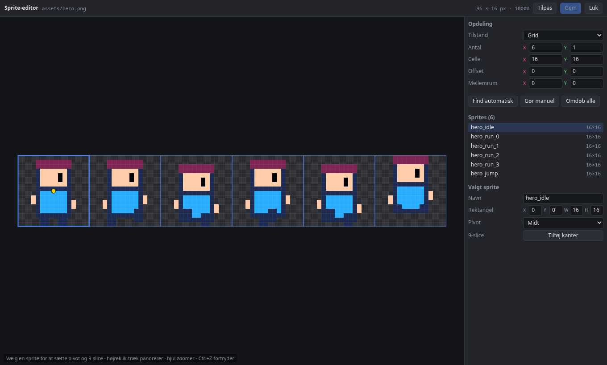

# Grafik

## Importér billeder

Importér PNG-filer med knappen eller ved at trække dem ind i asset-panelet.

## Sprite-editoren

Sprite-editoren åbnes, når du dobbeltklikker et billede.



Her kan du:

- opdele billedet i et grid, finde sprites automatisk eller tegne dem selv. Grid starter med én celle pr. figur i billedet, og under "Antal" kan du skrive kolonner og rækker i stedet for cellestørrelse. Til animationer er grid bedst, fordi alle frames så er lige store,
- sætte pivot,
- sætte 9-slice-kanter, som bruges til UI-paneler og knapper og til sprites med `drawMode: sliced`, der strækkes til en `size` uden at hjørnerne forvrænges (fx platforme og skilte).

## Animationer

Vælg et opdelt billede og tryk **Lav animation**. Dobbeltklik `.anim.json` for at åbne tidslinjen. Der kan du trække frames rundt, ændre varighed ved at trække i kanten, bruge onion skin og sætte events på frames. Et event kommer til `onAnimationEvent(name)` i scriptet på samme entity.

Fra et script: `this.playAnimation("hero_run")`.

## Fra andre værktøjer

- **Aseprite og TexturePacker:** Importér `.png` og `.json` sammen. Du får sprites, og Aseprite-tags bliver til animationer.
- **Tiled:** Se [Tilemaps](tilemaps.md#fra-tiled).
- **BMFont (`.fnt`):** Importér `.fnt` og dens `.png` sammen. Du får en bitmap-font, se [Bitmap-fonte](#bitmap-fonte-pixel-tekst).

## Kamera

Kameraet bestemmer, hvad Spil-fanen viser. Lad det følge spilleren med `CameraFollow2D`. Slå `useBounds` til og sæt `bounds` til banens kanter, så holder kameraet hele udsnittet inden for banen, uanset hvor stort vinduet er.

### Parallax: lag i baggrunden

`Parallax2D` får en entity og dens børn til at følge kameraet med kun en del af farten, så baggrunden får dybde: fjerne bjerge langsomt, nærmere huse hurtigere. `factor` er den andel af kameraets bevægelse, laget *ikke* flytter sig med: 1 er en almindelig entity, 0 står fast på skærmen (et bagtæppe), 0,5 flytter sig med halv fart. Der er en værdi for x og en for y. Husene i en gade har typisk `(0.65, 1)`: de glider i x, men står stadig på jorden.

1. Lav en tom entity som lag, og sæt `Parallax2D` på den.
2. Læg lagets sprites som børn under den, og giv dem en lav `layer` i `SortingOrder`, så de tegnes bag banen.
3. Lagets egen position er, hvor det ligger, mens kameraet står i (0, 0). Lav laget bredt nok til hele banen: et lag med `factor` 0,5 flytter sig kun halvdelen af kameraets vej, så det behøver kun at dække halvdelen af banens bredde plus skærmen.

**I editoren:** så længe knappen **Parallax** i Scene-fanens værktøjslinje er slået til, viser Scene-fanen lagene, som spillets kamera vil se dem, når det står midt i det udsnit, du kigger på. Placér en baggrundsbygning bag kassen i Scene-fanen, så står den bag kassen, når kameraet kommer dertil i spillet. Når du panorerer, glider lagene, ligesom de gør i spillet, og du kan vælge og trække ting dér, hvor du ser dem. Det er kun visningen, der ændres: tallene i inspectoren er stadig lagets position, når kameraet står i (0, 0). Zoomer du langt ud, passer lagene kun midt i billedet. Slå knappen fra for at se alt stå stille. Knappen vises kun, når scenen har et parallax-lag.

Laget følger kameraet i samme frame, så der er ingen rystelser. Kameraet er det, der tegnes først, med mindre feltet `camera` peger på et andet. Kun entities øverst i hierarkiet kan være lag.

### Skærmryst, zoom-stød og hit-stop

Fire kald fra et script giver spillet vægt. De ændrer kun, hvad der tegnes: kameraets entity flyttes ikke, så `CameraFollow2D` og grænserne virker som før, og UI'et ryster ikke.

| Kald | Virkning |
|---|---|
| `this.shakeCamera(8, 0.3)` | Ryster skærmen højst 8 pixel og aftager over 0,3 sekunder. Flere ryst lægges sammen |
| `this.punchCamera(0.08, 0.2)` | Zoomer hurtigt 8 % ind og glider tilbage. Et negativt tal zoomer ud |
| `this.hitStop(0.06)` | Fryser spillet i 0,06 sekunder, fx når et slag rammer. Animation, fysik og scripts står stille |
| `this.slowMotion(0.3, 1)` | Kører spillet med 30 % hastighed i 1 sekund og vender så tilbage |

Skærmryst og zoom-stød springes over, når spilleren har bedt styresystemet om mindre bevægelse (indstillingen "reducer bevægelse"). Spillet kan også selv bestemme det, fx fra en indstillingsmenu: `this.world.resource(CameraFX).reduceMotion = true` (eller `false`, eller `"auto"` for at følge styresystemet). Hit-stop og slowmotion påvirkes ikke.

Tiderne er rigtige sekunder, så et hit-stop varer lige længe, også i slowmotion. Et ryst ser ens ud hver gang, så et spil kan afspilles ens igen. Uden for scripts: `world.resource(CameraFX)` har de samme metoder plus `stop()`.

```ts
onCollisionEnter(other: number) {
  this.shakeCamera(6, 0.25);
  this.hitStop(0.05);
}
```

Til at lægge en farve over hele skærmen, fx et rødt blink ved skade, er der `world.resource(ScreenFade)` med `r`, `g`, `b` og `alpha` (0 tegner ingenting). Den ligger ovenpå alt, også UI.

## Partikler, tekst og former

| Komponent | Bruges til |
|---|---|
| `ParticleEmitter2D` | Partikler. De kan spille i verdens- eller lokale koordinater (`space`). Fra et script: `this.emitParticles(20)`. Med `collide` støder de mod faste colliders (ikke triggere): `bounce` er hoppet (0 til 1), `slide` hvor meget fart de beholder langs fladen, og `dieOnHit` lader dem forsvinde ved første stød, fx regn og gnister. `collisionMask` vælger, hvilke grupper de rammer. Kun partikler i verdens-koordinater kolliderer. |
| `Text2D` | Tekst i verden, i en browserfont eller en [bitmap-font](#bitmap-fonte-pixel-tekst) |
| `Shape2D` | Udfyldte og optegnede former. Gode til prototyper og fejlsøgning |
| `SpriteAnimator` | Afspiller en animation |

Alle felter står i [Komponentreferencen](komponenter.md).

## Bitmap-fonte: pixel-tekst

En browserfont bliver udglattet og passer sjældent til pixel art. En bitmap-font tegner i stedet hvert bogstav fra et billede, så teksten er lige så skarp som resten af spillet. Den virker i både `Text2D` og `UIText`.

En bitmap-font er en fil `navn.font.json` ved siden af billedet med bogstaverne. Du kan lave den på to måder:

- **Fra et billede med bogstaver i et grid.** Vælg billedet i Assets, fold **Lav bitmap-font** ud i inspectoren, og angiv cellestørrelsen og tegnene i den rækkefølge, de står i billedet (venstre mod højre, oppefra og ned). Med **Måle bredde pr. tegn** får hvert bogstav sin egen bredde, og en tom celle bliver et mellemrum. Uden den er alle bogstaver lige brede (monospace). Forhåndsvisningen viser resultatet, før du trykker **Lav bitmap-font**.
- **Fra et font-værktøj.** Træk en BMFont-fil (`.fnt`, som tekst eller XML) ind i Assets sammen med dens billede. Den laves af fx BMFont, Hiero og Littera. Kerning kommer med. Fonte med flere billeder bruger kun det første.

Brug fonten ved at skrive dens navn i feltet `font` på en `Text2D` eller `UIText`. Feltet foreslår projektets bitmap-fonte. `size` er linjehøjden, og står den på fontens egen linjehøjde eller et multiplum af den, bliver pixels skarpe. Fontens inspector viser linjehøjden og en prøvetekst.

```ts
this.get(Text2D).text = `Point: ${this.score}`; // samme kode som med en browserfont
```

Mangler fonten små bogstaver, bruges de store, og et tegn, der slet ikke findes, vises som `?` (hvis fonten har det). Fontens egen linjehøjde bruges, så `lineHeight` på `Text2D` virker kun på browserfonte. Billedet sættes til filteret *Nearest*, når fonten laves. I det eksporterede spil pakkes billedet altid helt, så bogstaverne ligger, hvor fonten siger. Omrids fra `SpriteMaterial` virker ikke på bitmap-tekst, men blink og additiv glød gør.

## Tegnerækkefølge

`SortingOrder` bestemmer, hvad der tegnes øverst: lave `layer` først, og inden for et lag lave `order` først. Med `ySort` sorteres efter y-position, så figurer længere nede foran dem længere oppe (top-down-spil).

## Lys og mørke

`Lighting2D` på kameraet gør verden mørk, og `Light2D` er lyskilder (punktlys og kegler med farve). Alt kameraet tegner ganges med lyset. UI'et påvirkes ikke. Se [Lys og mørke](../guide/lyssaetning.md) for en gennemgang.

| Komponent | Bruges til |
|---|---|
| `Lighting2D` | Sættes på kameraet. `ambient` er lyset overalt: sort er helt mørkt, hvidt er ingen mørkelægning |
| `Light2D` | En lyskilde med `color`, `intensity`, `radius`, `softness`, og som `spot` en keglevinkel. Peger langs entity'ens rotation |

Lys har endnu ingen skygger og ingen normal maps. Alle felter står i [Komponentreferencen](komponenter.md).

## Materialer: blink, omrids og glød

`SpriteMaterial` på en entity med `Sprite`, `Text2D` eller `Shape2D` ændrer, hvordan den tegnes. Sprites med materiale samles stadig med alle andre sprites i få draw calls.

| Felt | Bruges til |
|---|---|
| `flash` og `flashColor` | Farver figuren, men beholder dens form. 0 er intet blink, 1 er helt `flashColor`. Typisk hvid, når noget bliver ramt |
| `outlineWidth` og `outlineColor` | Et omrids, målt i billedets egne pixels (fx 1 til pixel-art). Kun på sprites og tekst, og omridset kan ikke gå uden for spritens ramme, så giv billedet lidt tom kant |
| `blend` | `additive` lægger farven oven i det bagved, så lyse farver gløder. Godt til ild, gnister og magi |

Fra et script blinker `this.flashSprite(0.1)` entity'en hvidt i 0,1 sekund og falmer ud. Komponenten tilføjes af sig selv, hvis den mangler. Blinket tæller spiltid, så det står stille under et hit-stop.

```ts
onCollisionEnter(other: Entity) {
  this.flashSprite(0.12);                              // hvidt blink på mig selv
  this.flashSprite(0.2, { r: 1, g: 0.2, b: 0.2 }, other); // rødt blink på den anden
  this.hitStop(0.05);
}
```

## Effekter på hele billedet

`PostProcess2D` på kameraet lægger effekter over alt, hvad kameraet tegner, også lyset. UI'et tegnes bagefter og forbliver skarpt. Hver effekt er slået fra ved sin standardværdi, så du kun skruer op for dem, du vil have.

| Felter | Effekt |
|---|---|
| `bloom`, `bloomThreshold`, `bloomRadius` | Lyse dele gløder. `bloomThreshold` er, hvor lyst noget skal være for at gløde |
| `brightness`, `contrast`, `saturation`, `tint` | Farvekorrektion. `saturation` 0 giver sort-hvid |
| `vignette` | Mørkere hjørner |
| `scanlines`, `scanlineSpacing`, `curvature`, `chromaticAberration` | CRT: linjer hen over billedet, en buet skærm, og rød og blå, der glider fra hinanden mod kanten |
| `pixelate` | Tegner billedet i blokke på så mange skærmpixels |

Felterne kan ændres, mens spillet kører, fx fra et script på kameraet: `this.get(PostProcess2D).saturation = 0`, når spilleren dør. Effekterne vises kun i Spil-fanen og i det eksporterede spil, ikke i Scene-fanen. Hvert kamera har sine egne effekter. Et kamera med effekter tegnes først ind i en tekstur, så det koster lidt mere, især med bloom.
